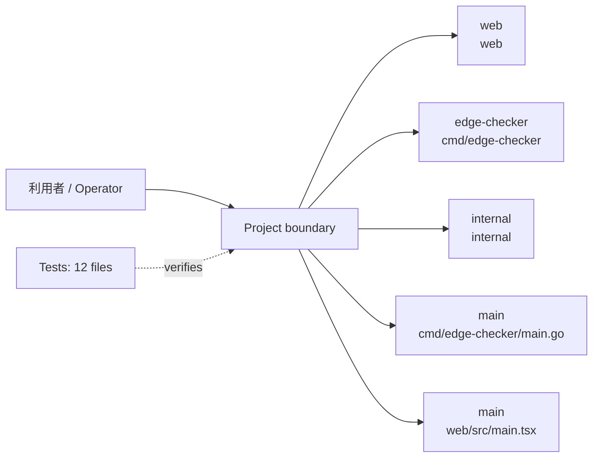
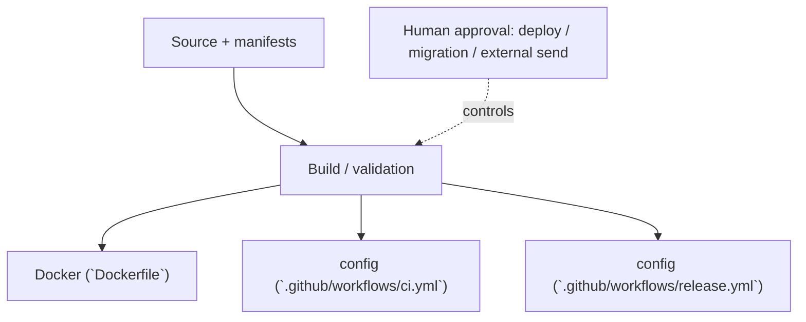

<!-- generated-by: scripts/generate_engineering_docs.py -->
# edge-checker — アーキテクチャ・システム構成

> 生成日: 2026-07-15 / 対象: `edge-checker` / 確度: [高]
> 実装・manifest・既存資料の静的棚卸しに基づく。外部サービスの稼働状態と本番構成は未検証。

## 論理アーキテクチャ

## 配備・実行構成

## コンポーネント責務

| Component | Path | 責務 |
|---|---|---|
| `web` | `web` | 利用者向けUIとWebアプリケーション境界 |
| `edge-checker` | `cmd/edge-checker` | CLI・バッチ・運用入口 |
| `internal` | `internal` | 中核実装。詳細は配下moduleを参照 |
| `main` | `cmd/edge-checker/main.go` | 実行entrypoint |
| `main` | `web/src/main.tsx` | 実行entrypoint |

### 検出したruntime / service

- `Docker (`Dockerfile`)`
- `config (`.github/workflows/ci.yml`)`
- `config (`.github/workflows/release.yml`)`

## 実装境界

- UI/入口: UI route未検出
- API: API route未検出
- Data: 永続schema未検出
- External: integration名を静的検出できず

## セキュリティ境界

- 認証・回復性の実装シグナル: rate-limit (`web/src/utils/packetSampler.ts`), rate-limit (`web/src/components/dashboard/SummaryCards.tsx`), rate-limit (`web/src/components/flow/Packet.tsx`), resilience (`internal/httpclient/client.go`), resilience (`internal/cli/security_test.go`), resilience (`internal/cli/run.go`), auth/session (`internal/cli/dryrun.go`), resilience (`internal/safety/dns.go`), auth/session (`internal/safety/policy_test.go`), auth/session (`internal/safety/policy.go`), auth/session (`internal/safety/preflight.go`), resilience (`internal/scenario/validator.go`)
- 設定名: example/sourceから未検出（値は収集していない）
- deploy、migration、外部送信、課金はHuman Approval Gate対象。
